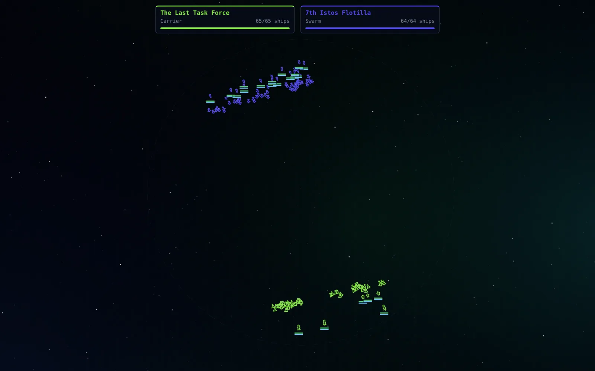
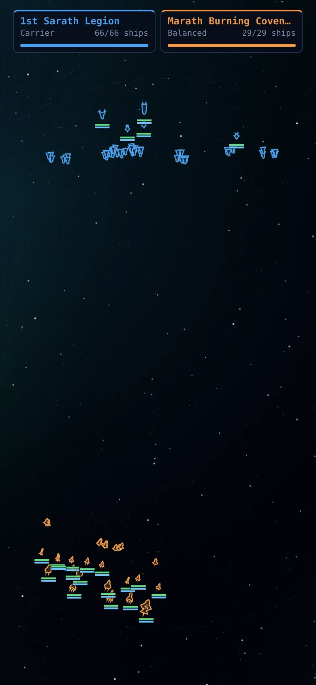

# Random Space Battles

[](https://github.com/ali-raheem/random-space-battles/actions/workflows/ci.yml) [](https://github.com/ali-raheem/random-space-battles/actions/workflows/pages.yml)

**▶ Try it live: [shoryuken.me/rsb](https://shoryuken.me/rsb/)** · mirror on [GitHub Pages](https://ali-raheem.github.io/random-space-battles/) · installable, works offline

<p align="center">
  <a href="https://shoryuken.me/rsb/"></a>
  <a href="https://shoryuken.me/rsb/"></a>
</p>

An endless, hands-off space battle generator. Each battle pits two (sometimes three)
procedurally generated fleets against each other. When one side is left standing,
a victory banner shows and a brand new battle starts.

No build step, no dependencies, no network calls. Plain HTML/CSS/JS modules plus a
service worker, so it installs as a PWA and runs fully offline.

## Run it

```bash
python3 -m http.server 8080   # or: npm run serve
```

Open `http://localhost:8080/`. After the first load it works with the network off.
Use the browser's "Install app" / "Add to Home Screen" for a fullscreen app.

## Controls

| Key | Action |
|---|---|
| Space | Pause / resume |
| `+` / `-` | Simulation speed (0.5× – 4×) |
| `N` | Skip to a new battle |
| `R` | Fleet roster: every design and its generated weapons |
| `L` | Recent battles: the last 5 you watched, with summary, replay and copy-link |
| `S` | Settings: install app, sound, health bars, fullscreen, hide interface, version |
| `B` | Toggle health/shield bars |
| `H` | Hide the whole HUD (tap the screen to bring it back) |
| `M` | Sound on/off (remembered) |
| `F` | Fullscreen |
| `Esc` | Close the open panel |

Controls fade after a few idle seconds, and the tab holds a screen wake lock
while it's visible. So it works as a screensaver. On a touchscreen, the first tap
brings faded controls back without pressing anything.

Every battle is fully determined by its seed, which is kept in the URL
(`#seed=0000002a`). Reloading replays the current battle. Click the seed to copy
a link to it.

## What gets randomised

- **Factions**: name, colour, doctrine (Swarm, Balanced, Line of Battle, Carrier,
  Raider), shield/armour/engine tech modifiers, and two favoured weapon types.
- **Ship designs**: one design per hull class per fleet (fighter → battleship), each with a
  procedurally generated hull outline and randomised hull, shields and speed.
- **Weapons**: type, damage, range, rate of fire, projectile speed, salvo size and colour.

| Weapon | Behaviour |
|---|---|
| Laser | Instant beam, fast cycling, can miss agile targets |
| Ion Beam | Shreds shields, weak against hull |
| Particle Lance | Huge long-range beam; spinal mount on small hulls (must face target) |
| Plasma Cannon | Slow, heavy bolts; strong against hull, weaker against shields |
| Autocannon | Rapid stream of small slugs |
| Railgun | Near-instant long-range slug, bypasses shields well |
| Torpedo | Slow homing warhead with big damage; can be shot down |
| Missile Swarm | Salvo of agile homing missiles |
| Point Defence | Short-range guns that shoot down missiles and fighters first |

Shields absorb damage first and regenerate after 3 s without being hit. A battle
that runs to 4 minutes ends in a ceasefire, and the fleet with the most remaining
strength wins.

## Structure

| File | Purpose |
|---|---|
| `js/rng.js` | Seeded PRNG (mulberry32) |
| `js/gen.js` | Faction, design, hull-shape and weapon generation. Balance tables live here |
| `js/sim.js` | Deterministic, DOM-free simulation: steering AI, targeting, projectiles, damage |
| `js/audio.js` | Synthesised Web Audio effects: per-weapon sounds, explosions, ambient drone, victory fanfare |
| `js/recent.js` | Recent-battles list: summaries, de-duplication, `localStorage` persistence |
| `js/render.js` | Canvas renderer: parallax stars, nebula, ships, beams, particles, camera |
| `js/app.js` | Fixed-timestep loop, HUD, controls, panels, battle rotation |
| `js/version.js` | Release version and build time, shown in Settings |
| `index.html` | Page shell, including the SVG icon sprite (`#i-*` symbols) |
| `sw.js`, `manifest.webmanifest` | Offline caching + install metadata |
| `tests/sim.test.mjs` | Generation validity, determinism, battles always terminate |
| `tests/assets.test.mjs` | Every shipped file is in the service worker's cache list |

To tune pacing, change `DAMAGE_SCALE` in `js/gen.js` (lower means longer battles) and
`TIME_LIMIT` in `js/sim.js`. If you add a file, add it to `ASSETS` in `sw.js` too.

## Releasing

```bash
npm run bump            # patch; or: npm run bump -- minor | major
```

This updates `VERSION` and the `BUILT` timestamp in `js/version.js` (and
`package.json`). The service worker is registered as `sw.js?v=<VERSION>` and names
its cache after it, so installed copies pick up a clean cache on their next visit.

## Tests

```bash
npm test
```

## Licence

[MIT](LICENSE) © 2026 Ali Raheem.
